# CPPR Studio

A graphical design tool for **multi-section concentric push–pull robots (CPPRs)**.

**Live demo:** [andrecox.github.io/cppr-studio](https://andrecox.github.io/cppr-studio/) Set the tube stock, the material and the shape you want; the solver sizes every notch for maximum stiffness within the material strain limit, checks the design, and generates files for **3D printing** or **laser cutting**.

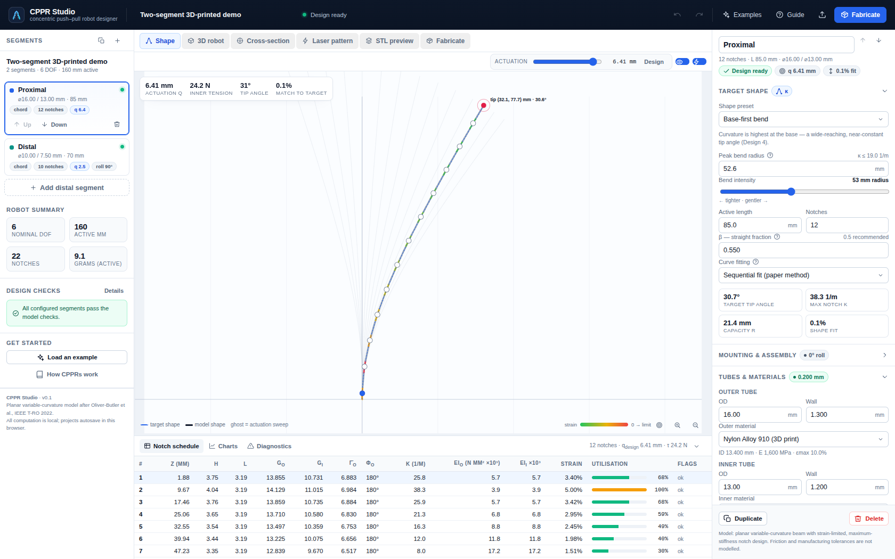

| Shape editor | Cross-section inspector |
| --- | --- |
| 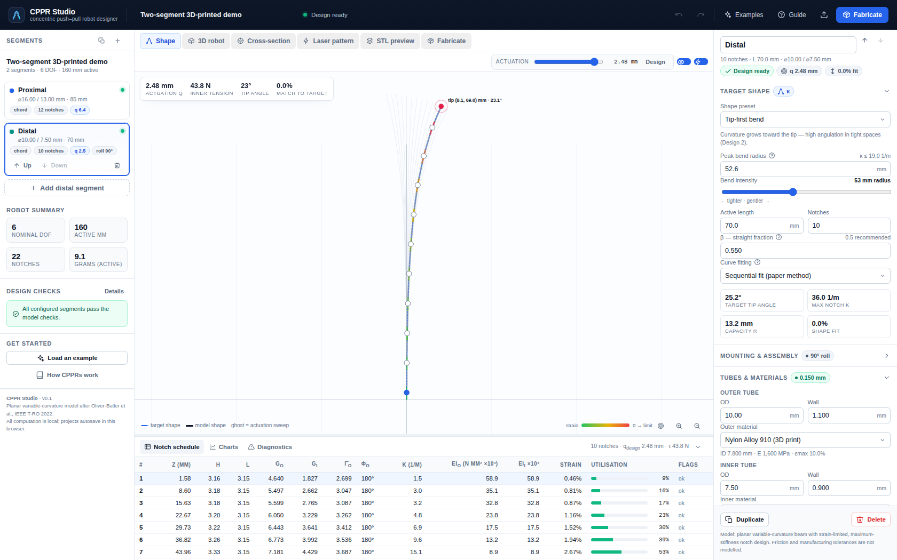 | 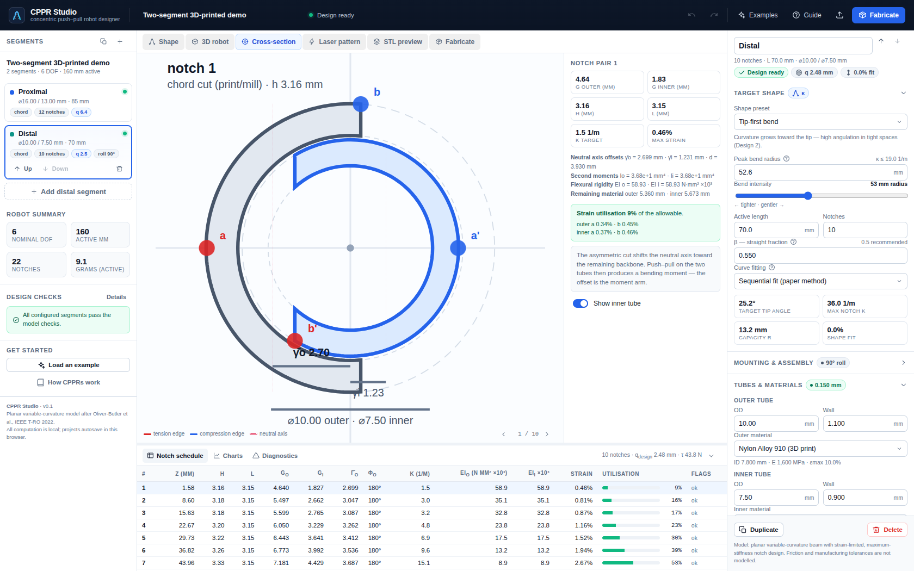 |

| Unrolled laser pattern | Fabrication package |
| --- | --- |
| 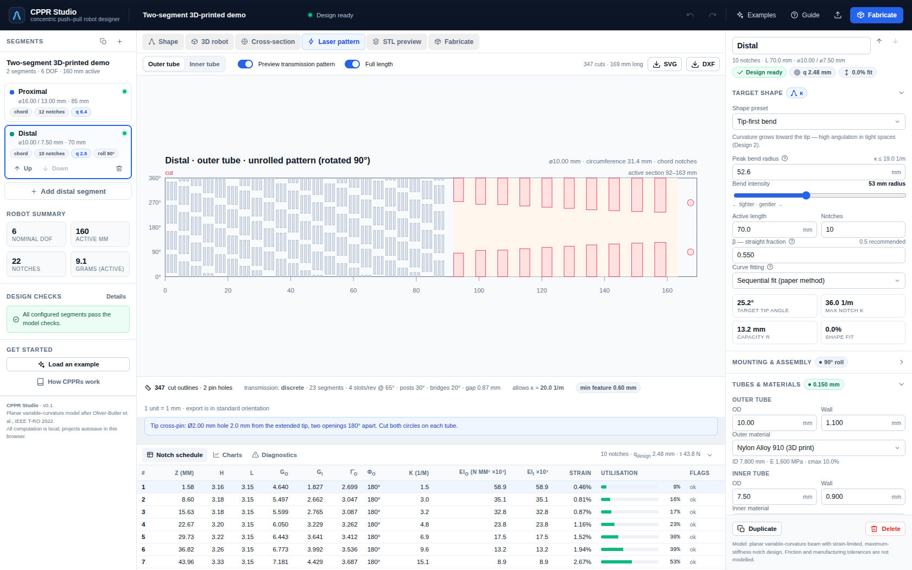 | 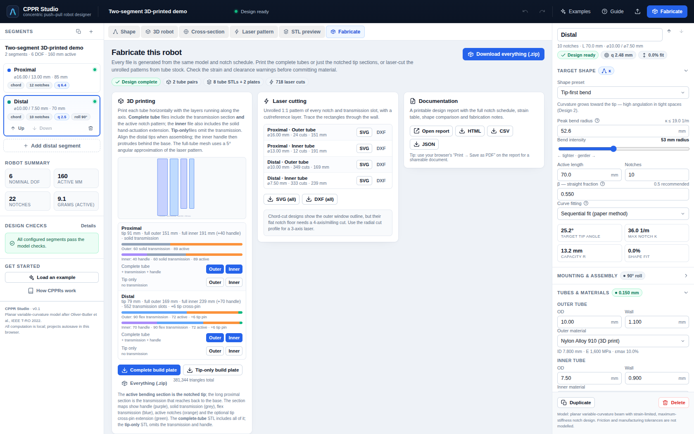 |

| Live STL preview | Tip cross-pin |
| --- | --- |
| 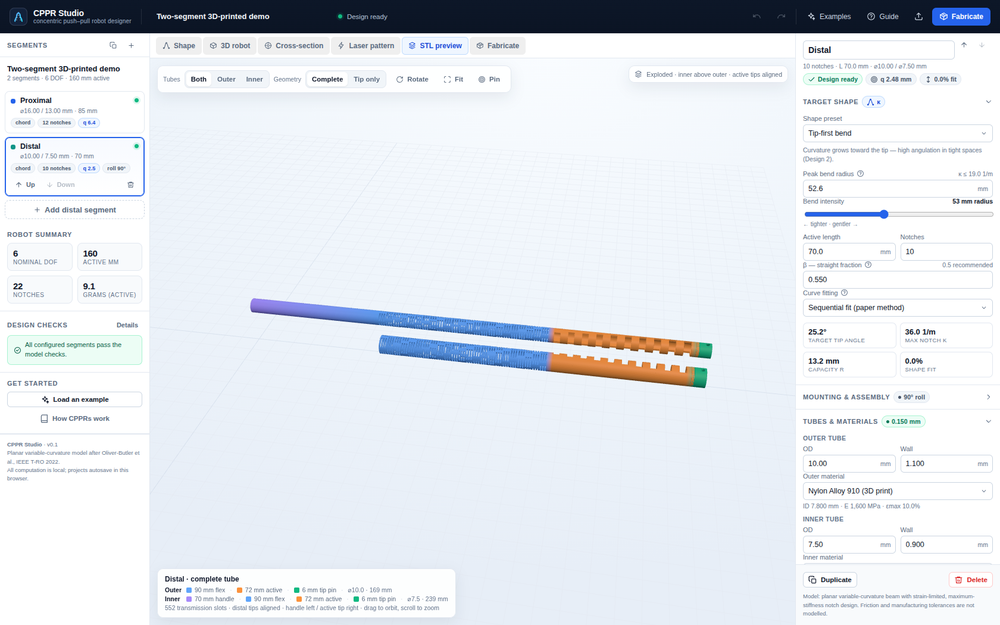 | 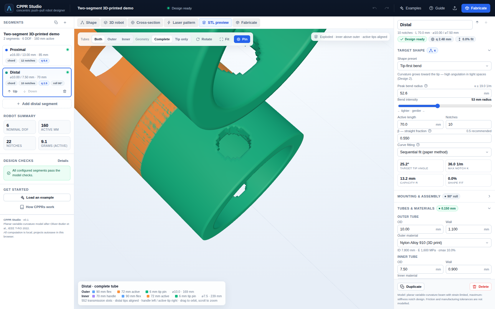 |

| Cosserat rod preview (WebAssembly) | Compare models |
| --- | --- |
| 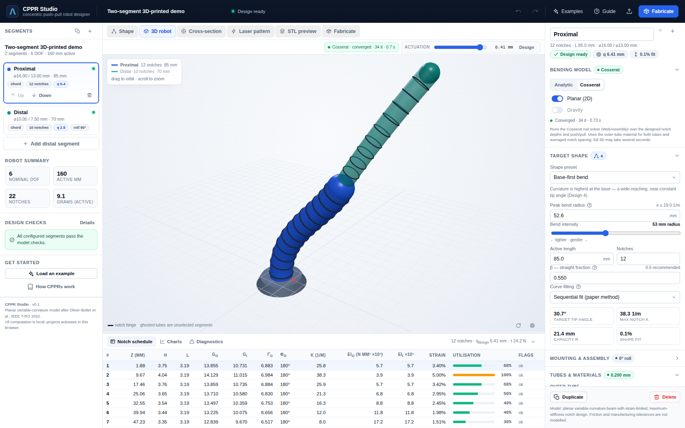 | 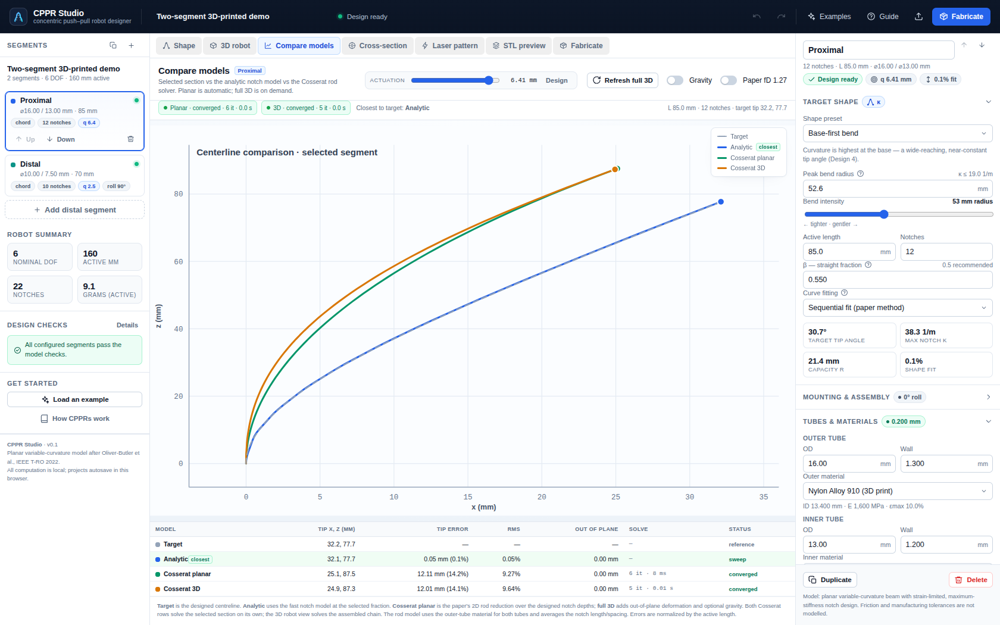 |

| Dark mode | 3D robot view |
| --- | --- |
| 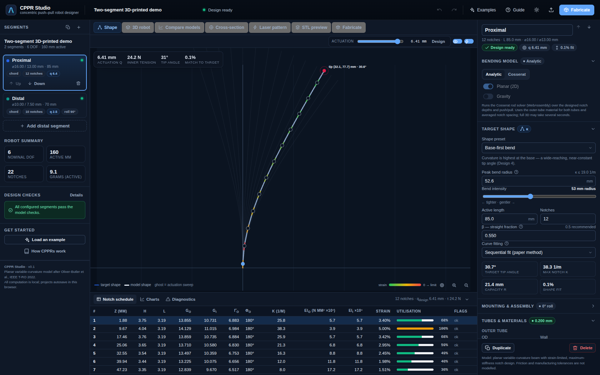 | 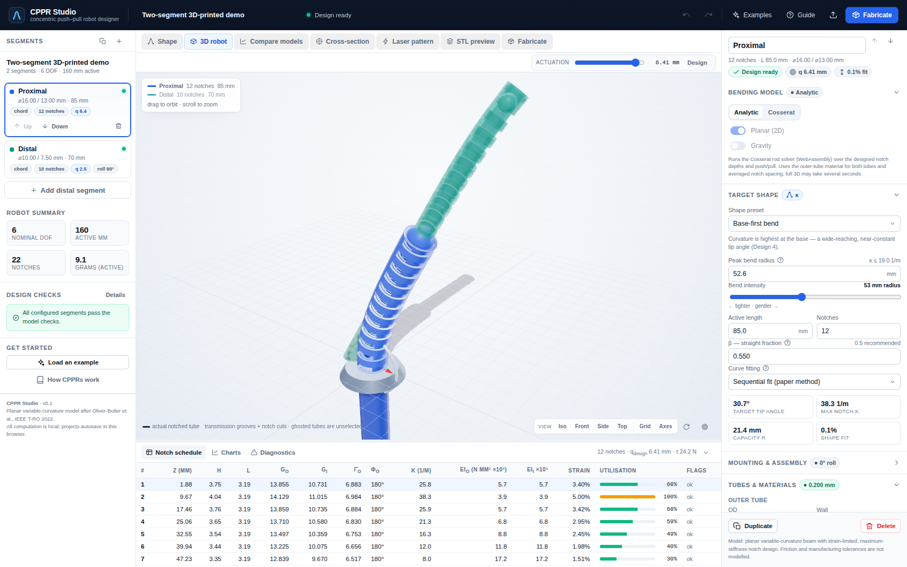 |

| Connected solid transmission | Design report |
| --- | --- |
| 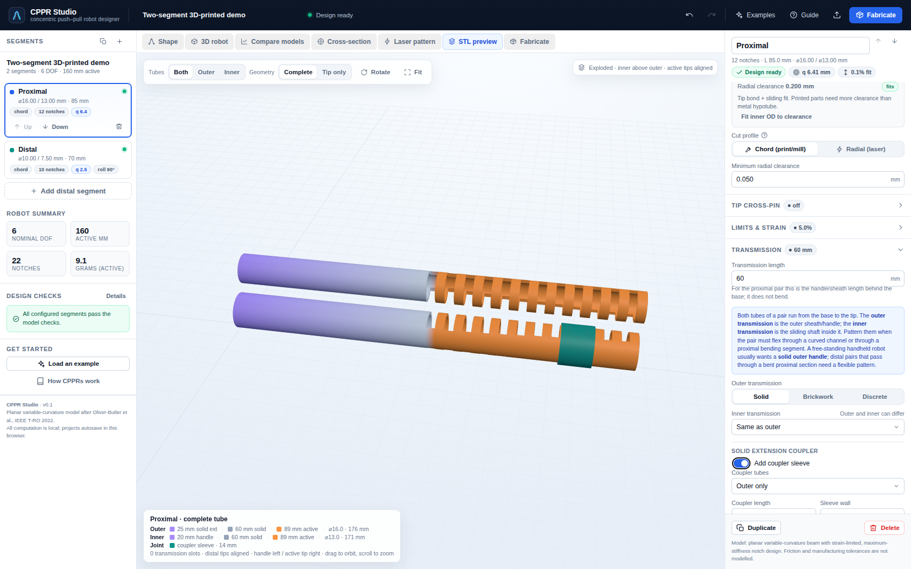 | 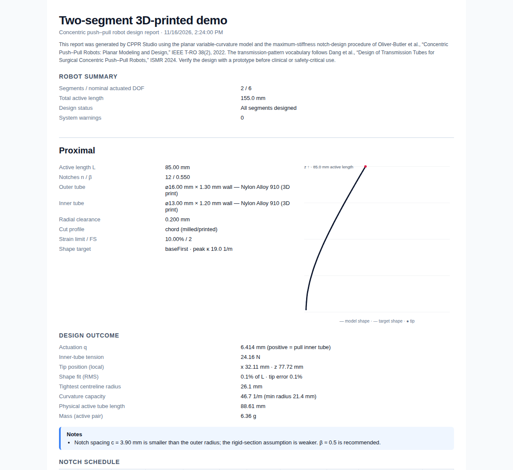 |

## Quick start

```bash
npm install
npm run dev          # prints the local URL (default http://localhost:5173)
npm run build        # production build in dist/
npm run preview      # serve the production build
```

Requires Node 18+ (developed on Node 24). The app is a static Vite/React/TypeScript site — deploy `dist/` to any static host. Everything runs locally in the browser; projects autosave to `localStorage` and no data leaves the machine.

## What it does

- **Multi-section robots.** Add nested tube pairs to the left rail, give each one a mounting roll, and inspect the resulting 3D assembly. Each enabled pair contributes insertion, bending and roll (3 nominal DOF).
- **Shape design.** Choose a curvature profile (constant arc, S-curve, tip-first, base-first, retroflex, mid-bend) and a peak bend radius, or switch to custom control handles and drag the target shape directly on the canvas.
- **Notch synthesis.** The paper’s maximum-stiffness algorithm sizes `g_o`, `g_i` and `h` for every notch, matches the inner/outer flexural rigidities and enforces the allowable strain with a safety factor. Depths, spacing and the number of notches are all under your control.
- **Transmission anatomy.** Both tubes of a pair run from the base to the tip; the proximal, un-notched part of each is its transmission. The outer tube’s transmission is the sheath/handle, the inner tube’s is the sliding shaft — they are not extra tubes. The outer and inner patterns are set independently. Pattern both when the pair must flex through a curved channel or a proximal bending section; a free-standing proximal handle can be solid. Distal pairs get a warning if their transmission is solid because it must follow the proximal bend. The inner tube can also have a solid proximal handle extension for hand actuation. Either tube can get a solid proximal extension joined to its transmission by a separate coupler sleeve; the coupler is exported as its own STL and shown in the complete-tube viewer.
- **Verification.** Strain utilisation per edge, depth caps, Euler buckling, self-contact limit, clearance, achievable curvature envelope, shape fit error, tip error and mass. The exact forward kinematics is solved at the design actuation and swept across a workspace for previews.
- **Hand actuation.** Give each inner tube a solid proximal **handle extension** so it can be gripped and pulled by hand. It is included in the complete inner STL and laser pattern; align the **distal tips** during assembly.
- **Tip cross-pin.** Optionally extend both tube tips with a short straight collar and a diametric cross-hole sized for 1.75 mm filament. The two openings are 180° apart; a pin through the assembled pair locks the tips together. Toggle it off, or customize the tip extension, hole diameter, hole distance from the tip and clocking angle. The extension and holes are included in the printed STLs, the laser patterns and the live viewer (green).
- **Compare models.** A dedicated page overlays the target, analytic, Cosserat planar and on-demand full-3D centrelines for the selected segment, with tip error, normalized RMS, out-of-plane deflection, iterations, time and convergence. It highlights the closest model and updates the analytic/planar curves with the actuation slider. The comparison solves the selected section on its own; the 3D robot view solves the assembled chain. A Paper fD 1.27 toggle applies the paper's printed-prototype centroid calibration.
- **Cosserat preview.** The **Bending model** section in the right rail switches the 3D robot from the fast analytic model to the Rust Cosserat rod solver compiled to WebAssembly. It re-solves the designed notch depths and push/pull, reports convergence/iterations/time, and supports a planar (recommended) or full 3D + gravity mode.
- **Live STL preview.** A dedicated viewer rebuilds the actual printable outer/inner tube meshes as you change settings. Switch Both/Outer/Inner and Complete/Tip-only, orbit/zoom, auto-rotate or fit; handle (purple), solid transmission (grey), flex transmission (blue) and active notches (orange) are color-coded, with the distal tips aligned and the inner exploded above the outer.
- **Fabrication.** Binary STL for each tube in the print orientation (layers along the axis): **tip-only** files for the bending section and **complete-tube** files that include the transmission slots and the inner handle. Also a **tip-only build plate**, a **complete-tube build plate** (all full tubes in one STL), 1:1 unrolled SVG/DXF laser patterns, a printable HTML design report, notch CSV, full design JSON, and a **Download everything (.zip)** package containing all tubes, both plates, both laser files, the report, CSV, JSON and a README.
- **Connected transmission extension.** Add a solid proximal extension to the outer and/or inner tube and bridge the joint to the existing transmission with a separate coupler sleeve. The extension is included in the complete tube and laser pattern; the coupler is its own STL in the individual, complete-plate and everything exports.
- **3D robot view.** The actual notched tube meshes — transmission slots and notch cuts included — are bent into the final assembled configuration. Each distal pair's transmission is routed back through the upstream assembled path, so it bends inside the proximal section rather than running straight behind it. Environment-lit PBR materials, soft contact shadows, a solid selected pair with ghosted unselected pairs, plus Iso/Front/Side/Top presets with grid and axes toggles.
- **Light/dark theme.** Follows the system preference on first load, remembers your choice, and themes the UI, 2D shape, patterns, charts and 3D stage.
- **Usability.** Live 2D shape canvas with pan/zoom, 3D orbit view, cross-section inspector with neutral axes and strain edges, notch table and charts, examples, undo/redo, project import/export and autosave.

## How to use it

1. Pick the **tube stock and material** in *Tubes & materials* (outer OD/wall, inner OD/wall, material). Keep the radial clearance above your process minimum; the button fits the inner OD to the clearance.
2. Choose a **cut profile**: *chord* for milling or 3D printing, *radial* for 3-axis laser cutting.
3. Set the **target shape**, active length `L`, notch count `n` and β. The peak bend radius is the most intuitive input; the notch curvatures are roughly `1/(1−β)` times higher because only the notched fraction bends.
4. Review the **strain and fit** in the right rail and the bottom panel. Fix errors before exporting; warnings point at depth caps, buckling and EI mismatch.
5. Open **STL preview** to inspect the printable tubes live, then **Fabricate**. Use **Complete tube → Outer/Inner** for the full tubes (transmission + inner handle), **Tip only** for short bending sections, **Complete build plate** for all full tubes in one STL, or **Download everything (.zip)** for every file including both plates and the laser package.

The default project is a two-segment, 3D-printable robot with orthogonal bending planes. The **Examples** menu includes the 4 mm nitinol S-curve geometry from the paper (Table I), a laser-cut arc, and a blank project.

## Model

The tool implements the planar variable-curvature model and the notch design procedure of Oliver-Butler et al. (IEEE T-RO 2022). The transmission-pattern vocabulary follows Dang et al. (ISMR 2024). The optional **Cosserat** preview is the same rod model used in the research backend: it runs over the designed notch depths and push/pull, compiled to WebAssembly and loaded only when selected. The planar reduction is the default (matching these planar notch schedules); full 3D with gravity is available in the 3D robot view. It uses the outer-tube material for both tubes and averages the notch length/spacing.

For each notch pair, the tube neutral-axis offset γ̄ is obtained from the exact area/centroid/second-moment of the notched annular section (chord or radial cut), computed by integration and tabulated for fast inversion. With `d = γ_i − γ_o`, signed for the local bending direction:

```
κ_o = κ / (1 − γ_o κ),      κ_i = κ / (1 − γ_i κ)
τ d = E_o I_o κ_o + E_i I_i κ_i
q   = Σ d_j h_j κ_o,j
ε   = κ_o (R − γ̄_o)   and   κ_o (x_cut + γ̄_o)
```

The design solves the paper’s optimization: maximize the minimum notch flexural rigidity subject to

```
α_j = d_j / (E_o I_o,j + E_i I_i,j),    α_j ∝ κ_j
E_o I_o,j = E_i I_i,j
max strain ≤ ε_limit / safety factor
```

The benchmark notch (largest curvature) is solved first so its worst edge reaches the allowable strain; every other notch is then solved for the compliance target. The forward kinematics solves the couped `κ_o, τ` system with a damped Newton continuation, including the first-notch lockout when the inner tube is pushed, and builds the shape by integrating constant-curvature arcs and straight rigid sections.

**Validation.** With the published nitinol geometry and 2 % strain limit, the solver reproduces the paper’s Table I depths: e.g. `g_o = 3.69 mm` vs. 3.63–3.72 mm published, `g_i = 3.15` vs. 3.09–3.18, with a 2.1 % shape-fit RMS. The cross-section model also reproduces the paper’s Fig. 5 neutral-axis trend and the Table I EI equality within a few percent. These checks are in `tests/`.

## Fabrication notes

- The STL writer lays each tube flat on the bed (axis along +Y, lowest point at z = 0) so slicer layers run along the tube axis, as recommended in the paper.
- Laser patterns are unrolled on the outer surface; the cut outlines are the notch and transmission windows. A radial-notch design is directly 3-axis laser-cuttable. A chord-notch design has flat notch floors and needs 4-axis/milling (the UI flags this).
- The transmission section can be given a *discrete asymmetric* golden-angle pattern or a *brickwork* pattern. A discrete row contains `n` short circumferential slots, two α posts and (n−2) β bridges; the solid gap is derived from the required curvature with `κ_max ≈ 8c/L²`. The **complete-tube STL** includes these slots for printing (the mesh uses a 5° angular approximation) and, for the inner tube, the solid handle extension; the **tip-only STL** contains just the bending section. The printed demo makes the proximal pair solid (60 mm handle/sheath) and the distal pair flexible (90 mm, passing through the proximal bend); the active bending sections are the notched tips (85/70 mm). Use the transmission-length "Fit to upstream" control so the shaft is only as long as the reach requires. The Fabricate card's section maps show handle (purple), solid transmission (grey), flex transmission (blue) and active notches (orange). Use the Printable features preset for FDM (0.6 mm kerf, 1.2 mm pitch) or the paper/laser values for hypotube.
- Printed transmission patterns need laser-scale features enlarged: typical FDM needs ≥0.4 mm. The UI reports the smallest transmission feature and warns when it is below that.
- Bond the distal tips of each pair. Deburr every cut edge. Prototype one pair before building the robot.

## Limitations

The analytic design model and the default Cosserat preview are planar and frictionless, and neglect clearance take-up, notch self-contact, external loads, manufacturing tolerances and 3D stress concentrations. The optional full-3D Cosserat mode adds out-of-plane rod deformation and gravity, but not contact or friction. Multi-segment assembly is a kinematic stack of planar sections with a roll angle; it does not model the interaction of a distal pair’s transmission with the proximal lumen. The printed transmission mesh uses a 5° angular approximation of the exact laser pattern, and rows within a discrete bending segment are aligned so the posts stay continuous. These are engineering aids, not substitutes for FEA and physical testing.

## Project structure

```
src/core/
  geometry/section.ts       notched annulus properties, tabulated inverses, section outlines
  geometry/curve.ts         desired-curvature presets, custom splines, arc-length sampling
  model/mechanics.ts        section pair properties, strains, forward kinematics
  design/segment.ts         benchmark solve, notch depth/height synthesis, checks
  design/robot.ts           multi-segment assembly and 3D transforms
  fab/tubeMesh.ts           watertight notched-tube meshing, ASCII/binary STL
  fab/build.ts              per-tube and print-plate assembly
  fab/patterns.ts           unrolled laser patterns, SVG and DXF
  fab/transmission.ts       discrete/brickwork slot geometry shared by laser files and print meshes
  export/report.ts          HTML report, CSV, JSON
  cosserat/solver.ts        WASM rod-solver bridge and design mapping
  cosserat/assembly.ts      rod output → 3D renderer assembly
  cosserat/compare.ts       target/model curve localization and error metrics
src/components/             React UI (2D shape, 3D, compare models, cross-section, pattern, fabricate, …)
src/state/useProject.ts     undo/redo history and localStorage persistence
src/wasm/pkg/               generated wasm-bindgen JS + wasm (committed)
cosserat-wasm/              extracted Rust Cosserat crate and WASM wrapper
tests/                      section, mechanics/design, mesh, export tests
```

## Scripts

```
npm run dev        start the Vite dev server
npm run build      typecheck + production build
npm run preview    serve the production build
npm test           Vitest suite (model, validation against the paper, meshes, exports)
npm run wasm:build rebuild the Rust Cosserat solver WASM (Rust + wasm-bindgen-cli required)
```

## References

- K. Oliver-Butler, J. A. Childs, A. Daniel, D. C. Rucker, “Concentric Push–Pull Robots: Planar Modeling and Design,” *IEEE Transactions on Robotics* 38(2), 2022.
- K. T. Dang, S. Qiu, C. Hatch, P. Connor, T. Qin, R. Alterovitz, R. J. Webster III, D. C. Rucker, “Design of Transmission Tubes for Surgical Concentric Push-Pull Robots,” *ISMR*, 2024.

The two reference PDFs are kept locally for development and are not part of the public repository.
